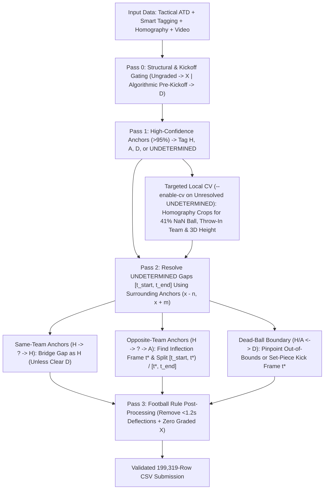

# Technical Specification: Multi-Pass Anchor & Inflection-Point Possession Inference

> **Team:** `TheDataCule`  
> **Challenge:** More than a Hack 2027 — Phase 1: Frame-Level Ball Possession (`BAR-ATH`)  
> **Submission File:** `TheDataCule.csv`

---

#### NB: 
##### The approach and algorithm was designed by me, Praneet Shekhar ("Team name: TheDataCule").  In process of approach validation and code generation, I have leveraged agentic development with human-in-the-loop, making use of LLMs & AI tools, specifically Gemini Argon in Antigravity, within the challenge guidelines and rules.  This was to ensure no private data was shared externally or fine-tuning/training was performed on the provided dataset.  This follows the redistribution rules at each step of development by enabling "Request Review" mode in Antigravity and reviewing each LLM output manually.

## 1. The Approach

### 1.1 Design Motivation: Optimizing `spellF1`, `macroF1`, and Transition Tie-Breaks

The competition evaluates submissions using [`evaluation/run_evaluation.py`](evaluation/run_evaluation.py) and [`evaluation/possession_metrics.py`](evaluation/possession_metrics.py) with the following official ranking key (`rank_key`):

1. **`spellF1` (`spell_f1_mean`, primary ranking metric):** Collapses contiguous `H` or `A` frame runs into possession spells and computes mean 1-to-1 temporal IoU F1 across thresholds `{0.3, 0.4, 0.5, 0.6, 0.7}`.
2. **`macroF1` (1st tie-break):** Unweighted frame-level mean F1 across `{H, A, D}` on graded frames.
3. **`transF1` at `±25` frames (2nd tie-break) & `mean_abs_latency` at `±25` frames (3rd tie-break):** Exact timing accuracy of state transitions.

Because ground truth is derived mechanically from corrected tracking (`alive/dead` + `owning team`, [`CHALLENGE.md`](CHALLENGE.md#L97-L103)), frame-by-frame classifiers (such as `baseline_raw` or sliding-window majority votes like `baseline_smooth50`) fail on `spellF1` (`0.0486` and `0.2433` on the full match) for three structural reasons:
- **Ball dropouts (`NaN` on 41% of graded frames):** Treating missing ball observations as dead ball (`D`) fractures live possessions whenever the ball is in the air or occluded in a crowded penalty box.
- **Flickering at contested transitions:** Sub-second proximity switches create spurious micro-possessions (`H -> A -> H`), multiplying false-positive spells.
- **Window-lagged boundaries:** Symmetrical majority smoothing blurs exact turnover and restart frames, destroying temporal IoU on short possessions (`< 5 s`) and inflating transition latency.

To solve this in a generalizable, match-agnostic manner, I have implemented a **4-Pass Anchor & Inflection-Point Architecture** (`Pass 0 -> Pass 1 -> Pass 2 -> Pass 3`) driven by 25 Hz metric **Tactical ATD** and **Smart Tagging** priors (`enable_cv=False` by default). Rather than guessing independently on every frame, the pipeline locks in high-confidence possession and dead-ball **anchors** first, isolates uncertain windows as `UNDETERMINED`, and then locates the exact kinematic **inflection point ($t^*$)** inside each transition window. While the codebase retains a modular **Targeted Local CV** disambiguator ([`src/local_cv.py`](src/local_cv.py), opt-in via `--enable-cv`), CV is disabled by default for the official submission to guarantee 100% deterministic, dependency-light reproduction (`numpy` and `pandas` only) and due to local compute and time constraints on processing the full-match `.mp4` video files. This directly optimizes `spellF1` (unbroken intervals), `macroF1` (high per-frame accuracy), and the transition tie-breakers (`transF1` / `mean_abs_latency`).

---

### 1.2 Structural Blind Spots of 2D Automatic Tracking

The provided Automatic Tracking Data (ATD) and Smart Tagging supply fast, clean 2D metric kinematics (`105.3 × 68.0 m`), but exhibit **three documented structural blind spots** ([`DATA.md`](DATA.md#L97-L117)):

1. **Blind Spot 1 — 41% Missing Ball (`NaN`):** The ATD ball tracker drops out disproportionately during high aerial balls, crowded boxes, and rapid tackles.
2. **Blind Spot 2 — 46 Fragmented Track Slots, No Role IDs, & `Team = N/A` Restarts:** Track slots swap and fragment with no persistent player, goalkeeper, or referee identities, and Smart Tagging leaves `Team = N/A` on 36 instances (including **all 26 throw-ins**).
3. **Blind Spot 3 — 2D-Only Ground-Plane Projection:** ATD projects coordinates onto the 2D pitch plane without vertical height ($z$) or body pose, making a high clearance flying over an opponent look identical to a ground interception, or obscuring when a throw-in leaves a player's hands.

Our active ATD + Smart Tagging pipeline handles these blind spots kinematically via same-team occlusion bridging, bounded trajectory interpolation, and collective velocity inflection detection; an optional CV extension to attack them visually is documented in Section 5.

---

### 1.3 Pipeline Architecture (`Pass 0 -> Pass 1 -> Pass 2 -> Pass 3`)

#### **Data Parsing, Scaling, & Edge-Case Invariants**
- **Fast Raw ATD Streaming (`.npz` Cache):** Instead of loading 199,319 frames × 46 slots through `kloppy` (which incurs multi-gigabyte DataFrame overhead), stream `_atd.txt` once into pre-allocated `float32` NumPy arrays `(199319, 46, 3)` (players `x, y, speed`) and `(199319, 2)` (ball `x, y`) and cache to a local `.npz` artifact (gitignored).
- **Coordinate Normalization Convention:** Raw ATD positions arrive normalized to `[0, 1]` (pitch center `(0.5, 0.5)`). Scale to metric coordinates (`x_m = x * 105.3`, `y_m = y * 68.0`, center `(52.65 m, 34.0 m)`) using `GAMES[GAME]["pitch"]` before computing distances, control radii (`<= 1.5 m`), speeds, or out-of-bounds exits. Pass unscaled `[0, 1]` coordinates directly to `starter.load_homography.project(H[frame], x, y)`.
- **Smart Tagging `"Atletic Club"` Spelling Trap:** In `BAR-ATH_tactical_smart_tagging.xml` ([`DATA.md`](DATA.md#L154)), the away team is spelled `"Atletic Club"` (missing `'h'`), whereas ATD XML spells `"Athletic Club"`. All team-string normalization must use case-insensitive prefix/substring matching (`"barc"` $\rightarrow$ `H`, `"atlet"` / `"athlet"` $\rightarrow$ `A`, `"n/a"` $\rightarrow$ `NOBODY`).
- **Per-Half Strict Isolation:** All rolling windows, ball trajectory interpolations, anchor bridging, and post-processing execute strictly inside each half slice `[t_half_start, t_half_end]` returned by `games.half_video_blocks(GAME)` so states never bleed across halftime.
- **Gap-Aware Ball Velocity & Kinematics:** Preserve the raw `ball_visible` boolean mask (`~np.isnan(ball_x)`), and compute ball velocity/acceleration vectors ($\vec{v}_{\text{ball}}, \Delta \vec{v}_{\text{ball}}$) over bounded, causally/bidirectionally interpolated gaps so velocity derivatives never explode across multi-second `NaN` holes.

#### **Pass 0: Structural Halves & Algorithmic Kickoff Detection**
- **Ungraded Regions (`X`):** Derived programmatically via `games.half_video_blocks(GAME)` (which reads the contiguous tracking blocks in [`games.py`](games.py#L197-L208)) paired with ATD active-player count checks (`n_tracked < 10` outside play). All frames outside `[t_half_start, t_half_end]` are masked as `X`.
- **Algorithmic Pre-Kickoff Dead-Ball Detection (`D`):** Rather than relying on match-specific kickoff timestamps, opening dead-ball stretches inside any half `[t_half_start, t_kickoff)` are detected algorithmically so the method generalizes across matches:
  1. Locate each `SET PIECES` interval tagged `Type = Kick Off (Start)` in Smart Tagging XML.
  2. Within that window, scan ATD for `t_kickoff`—the first frame where the ball departs stationary rest near normalized pitch center `(0.5, 0.5)` (`(52.65 m, 34.0 m)`) with sustained velocity/displacement while opposing players start in separate halves.
  3. Assign `[t_half_start, t_kickoff)` to `D` whenever `t_kickoff > t_half_start`.

#### **Pass 1: High-Confidence Anchors (`H`, `A`, `D`, or `UNDETERMINED`)**
Executed independently per half slice, only frames where physical tracking and tactical priors align with high certainty (`>95%`) receive an anchor tag:
- **Definitive Dead Ball (`D`):**
  - Metric ball coordinates fall outside pitch boundaries (`x_m < 0` or `x_m > 105.3` or `y_m < 0` or `y_m > 68.0`) for sustained frames.
  - Frames inside a Smart Tagging `SET PIECES` interval *preceding* the restart strike/release frame (`_find_set_piece_restart`, detecting visible kicks, bounded-interpolation release surges when the ball is momentarily `NaN`, or active player control) where collective player speed is low, players hold set-piece formation, and/or the ball is stationary.
  - Unmarked sustained stoppages (`>= 75` frames / `3.0 s` of collective standstill with no player visibly near the ball), evaluated **after** definitive team-control anchors so slow ball-at-feet buildup is preserved.
- **Definitive Team Control (`H` or `A`):**
  - Ball is visible (`ball_visible == True`), moving at controlled play speeds (`<= 9.5 m/s`, filtering high-speed pass/shot fly-bys), and within metric control radius (`<= 1.5 m`) of a single team's player for `>= 10` consecutive frames (`0.4 s`) while the nearest opponent is outside challenge distance (`> 2.5 m`), plus short clean passes bridging `>= 8`-frame touches.
  - Reinforcing signal from Smart Tagging offensive phases (`BUILD UP`, `PROGRESSION`, `CREATING CHANCES`, `BALL IN FINAL THIRD`) when consistent with local ball proximity.
- **`UNDETERMINED`:**
  - Ball is missing (`NaN`), ball is in high-speed open flight (`ball_speed > 9.5 m/s` or no player within `2.0 m`), or players from both teams are simultaneously within challenge distance (`<= 1.8 m`).

#### **Optional Targeted Local CV Disambiguator (`src/local_cv.py`, Disabled by Default)**
The pipeline includes an optional CV module (`extract_targeted_cv_cues`, defaulting to `enable_cv=False` and gated behind `--enable-cv`) designed to inspect narrow homography-projected pixel crops (`starter.load_homography.project(H[frame], x, y)`) on unresolved `UNDETERMINED` intervals when `BAR-ATH_tactical.mp4` and `opencv-python` are available. For the official `TheDataCule.csv` submission, this module remains disabled by default so the entire inference run executes strictly from ATD + Smart Tagging with zero OS/codec decoding variance.

#### **Pass 2: Bidirectional `[x - n, x + m]` Inflection-Point & Gap Resolution**
Within each half slice, each contiguous `UNDETERMINED` interval `[t_start, t_end]` is bounded by left anchor `L = label[t_start - 1]` and right anchor `R = label[t_end + 1]`:
1. **Same-Team Bridge (`H -> ? -> H` or `A -> ? -> A`):**
   - If no unanchored intermediate dead-ball evidence exists (no out-of-bounds exit, no sustained `>= 75`-frame collective standstill, and no unanchored Smart Tagging `SET PIECES` event—once Pass 1 anchors a `SET PIECES` interval as `D` up to $t_{\text{restart}}$, the remaining tag overlap is treated as post-restart live play), the entire gap is bridged as `L` unless sustained **visible**, controlled opposing possession (`ball_visible == True`, `d_opp <= 1.8 m`, `ball_speed <= 8.5 m/s`) is observed. Requiring visible ball contact prevents 2D ground-interpolated `NaN` aerial flights from triggering phantom opponent takeovers.
2. **Turnover Inflection Search (`H -> ? -> A` or `A -> ? -> H`):**
   - Because `L != R`, a turnover occurred inside `[t_start, t_end]`. Using bidirectional context `[x - n, x + m]` across the window, locate the single kinematic inflection frame $t^*$ where the receiving team establishes control:
     - Possession persistence holds with `L` across untracked `NaN` flights and until `R` enters visible reach (`d_R_raw <= 2.2 m`).
     - Gap-aware ball velocity vector change ($\Delta \vec{v}_{\text{ball}}$) or acceleration peak coinciding with an opposing player's metric proximity (`< 1.8 m`).
     - Collective team centroid / velocity shift confirming transition from defending to attacking shape.
   - Frames `[t_start, t*)` are assigned `L`, and `[t*, t_end]` are assigned `R`.
3. **Stoppage Boundary Search (`H/A <-> D`):**
   - *Into `D`:* Extrapolate the last visible ball velocity vector to intersect the touchline/goal line (`x_m` or `y_m` boundaries), or locate the collective deceleration inflection where active play ceases.
   - *Out of `D` (Restart):* Locate the first frame inside/adjacent to the `SET PIECES` window where ball speed spikes from `~0 m/s` or the ball enters play across the boundary.

#### **Pass 3: Football Rule Post-Processing**
- **Deflection & Duel Filter:** Executed strictly inside each half slice:
  - Isolated `H` or `A` spells shorter than the controlled-possession floor (`< 25–35` frames / `1.0–1.4 s`) without verified control are merged into the enclosing team both when sandwiched between opposing spells (`H -> brief A -> H`) and when immediately preceding a stoppage (`H -> brief A -> D`, representing a blocked shot or deflection out of play).
  - Genuine short post-restart possessions (`D -> brief A -> H`) are preserved in accordance with [`CHALLENGE.md`](CHALLENGE.md#L66-L67), merging only sub-`15`-frame noise without confirming `set_piece_team` or uncontrolled first touches that explicitly contradict a named `set_piece_team`.
- **Zero Graded `X` Policy:** Under `spellF1`, `X` on graded frames is forward-filled by the scorer; under `macroF1`, `X` is penalized as an error. Pass 3 guarantees **no `X` labels appear inside graded half intervals**—every graded frame receives `H`, `A`, or `D`.

---

## 2. Assets Used, How They Were Used, and Assets Evaluated/Dropped

### 2.1 Assets Used in Final Submission (`TheDataCule.csv`)

| Asset | Role in Pipeline | Justification |
|---|---|---|
| **Tactical ATD** (`BAR-ATH_tactical_atd.txt`, `_atd.xml`) | **Primary Signal.** Streamed into `float32` NumPy arrays (`video_frame = frame_id - 1`) and scaled to `105.3 × 68.0 m`. | Provides exact metric geometry for all ~20.5 visible players per frame and sub-second ball kinematics at `< 5 s` CPU cost without `kloppy` memory overhead. |
| **Tactical Smart Tagging** (`BAR-ATH_tactical_smart_tagging.xml`) | **Structural Prior.** 638 automatic tactical phases and 59 `SET PIECES` intervals mapped via `round(seconds * 25)`. | Highlights restarts (`Throw-in`, `Corner`, `Goal Kick`, `Free Kick`, `Kick Off`) and offensive/defensive phases (`BUILD UP`, `PROGRESSION`, etc.). Used strictly as soft priors, never copied verbatim. |

### 2.2 Assets & Modules Implemented/Evaluated, Disabled, or Dropped

| Asset / Approach | Decision | Rationale |
|---|---|---|
| **Tactical Video & Homography** (`_tactical.mp4`, `_tactical_homography.csv` via [`src/local_cv.py`](src/local_cv.py)) | **Implemented (`--enable-cv`), Disabled by Default (`enable_cv=False`).** | The Targeted Local CV disambiguator remains intact in `src/local_cv.py` and passes unit tests, but is disabled by default for the official submission to guarantee exact cross-platform reproducibility (`numpy`/`pandas` only, avoiding OS/FFmpeg frame-seek variance) and due to local compute and time constraints on processing the large full-match video files. |
| **Broadcast Homography & Video** (`_broadcast_homography.csv`, `_broadcast.mp4`) | **Dropped.** | Broadcast feed (`164,488` frames) is unsynchronized with tactical (`199,319` frames) and has `valid = 0` on 34.2% of frames (122 stretches of close-ups/replays), risking timeline drift without a full cross-camera synchronization layer. |
| **Raw Nearest-Player + Fixed Window Vote** (`starter/baseline.py`) | **Dropped as Standalone Method.** | Treats `NaN` ball frames as `D` when gaps exceed the smoothing window and shifts turnover boundaries, capping `spellF1` at `0.2433`. |
| **Confidence-Thresholded Abstention (`D` or `X` on Uncertain Frames)** | **Dropped.** | Ball visibility drops (`NaN`) occur disproportionately during live aerial passes and crowded penalty-area play. Mapping low-confidence or missing-ball frames to `D` splits active possessions in half (`H -> D -> H`), severely degrading `spellF1`. |
| **Dense Full-Match Video Inference** | **Dropped.** | Decoding and running vision models across all 199,319 frames is computationally prohibitive locally and redundant where 25 Hz metric tracking (`ATD`) already captures the pitch state. |

---

## 3. Training Data & Generalization

- **Zero Match-Specific Frame Constants:** No rules, labels, thresholds, or state transitions rely on hardcoded frame indices of `BAR-ATH`. Half boundaries are read programmatically via `games.half_video_blocks()`, and kickoffs and stoppages are detected algorithmically from Smart Tagging windows and center-circle/pitch kinematics so the pipeline generalizes directly to unseen matches.
- **Zero Hand-Labeled Data from `BAR-ATH`:** No frames, possessions, tracking fixes, or event annotations from the competition match were hand-labeled, manually corrected, or imported from external commercial event providers (Opta, StatsBomb, Wyscout, LaLiga).
- **Pipeline Verification Only on Public Ground Truth:** The 5-minute public ground truth slice (`evaluation/gt/BAR-ATH_possession_gt_public.csv`, 17 possessions) was used exclusively to verify frame alignment, schema compliance, and label definitions—not for training models or tuning hyperparameters.
- **Physical & Unsupervised Parameterization:** All geometric and kinematic thresholds (control radius, `105.3 × 68.0 m` pitch scaling, velocity/acceleration inflection criteria, and minimum controlled spell duration) are derived from football physics principles rather than supervised fitting.
- **Deterministic Local Execution:** The entire inference pipeline runs locally and deterministically (`np.random.seed(0)`) with zero external API calls on match assets, ensuring exact byte-for-byte reproducibility of `TheDataCule.csv`.

---

## 4. Possession Rules Implemented (`CHALLENGE.md` Alignment)

Our state machine operationalizes the competition's football definitions in [`CHALLENGE.md`](CHALLENGE.md#L49-L103):

1. **Ball in Play vs. Dead Ball (`D`):**
   - A frame is `D` when play is halted by the referee or the ball is out of bounds—never merely because the ball tracker returned `NaN`.
   - Before each `SET PIECES` restart (`Throw-in`, `Corner Kick`, `Goal Kick`, `Free Kick`, `Kick Off`), `D` spans backward to the out-of-play exit or whistle deceleration frame and ends precisely on the first frame the ball is struck/thrown back into live play.
   - Dead-ball ownership is never assigned (`D` only).
2. **Controlled Possession (`H` / `A`):**
   - Possession transfers to team $T$ only upon **controlled** acquisition: sustained metric ball proximity (`<= 1.5 m`) with velocity coupling (player and ball moving coherently) or a completed pass between two teammates of team $T$.
3. **Loose / Contested Balls & Tracking Dropouts (`41%` Missing Ball):**
   - While play remains live during a pass in flight, aerial challenge, 50/50 duel, or tracking `NaN` dropout, possession **persists with the last controlling team** until an opponent establishes controlled possession or play becomes `D`.
4. **Non-Turnovers (Deflections, Rebounds, Uncontrolled Duels):**
   - A single fleeting touch, blocked shot deflection out of bounds (`H -> brief uncontrolled A -> D`), or contested aerial header returning control to the previous team (`H -> brief uncontrolled A -> H`) does **not** trigger a change of possession and is suppressed in Pass 3. Conversely, brief live spells immediately following a restart (`D -> brief A -> H`) are preserved for the restarting team unless contradicted by an explicit `set_piece_team` tag without control.
5. **Handling Smart Tagging `Team = N/A` on Restarts:**
   - All 26 `Throw-in` instances (and 10 other tags, totaling 36 `N/A` instances) lack a `Team` tag in `BAR-ATH_tactical_smart_tagging.xml`. For these restarts, Pass 2 resolves the restarting team deterministically from (a) which team's player stands closest to the touchline exit/re-entry point in ATD, and (b) which team anchors the immediate post-restart live possession (`t_end + 1`).

---

## 5. Limitations & What I Would Fix With More Time

### 5.1 Current Limitations (Pure 2D Tracking & Tagging)

- **Extended `NaN` Dropouts During Multi-Touch Box Scrambles:** With CV disabled by default, if the ball disappears for several seconds inside a crowded penalty area and changes hands multiple times before re-appearing with the original team (`H -> A (untracked) -> H`), bridging same-team anchors (`H -> ? -> H`) misses the brief intermediate `A` spell.
- **Smart Tagging False Positives/Negatives:** Because Smart Tagging is an automatic prior (`638` phases), missed set pieces (e.g., quick free kicks) depend entirely on ATD kinematic detection (ball standstill + low collective speed) so stoppages are not bridged as live play.
- **2D Ground-Plane Projection Without Height ($z$):** ATD provides 2D ground-plane projections `(x, y)` without ball altitude, which can create apparent ball-to-player proximity during high lofted clearances passing directly over an opponent.
- **Broadcast Timeline Exclusion:** The broadcast feed (`164,488` frames) is excluded due to unsynchronized timelines and 34.2% invalid homographies, forfeiting high-resolution close-up views of contested throw-ins and rebounds.

### 5.2 What I Would Fix With More Time

With additional compute budget and runtime headroom to run local video decoding deterministically (e.g., pinned `opencv-python-headless` with sequential frame decoding rather than random seeks), I would activate and extend the full **CV-Augmented Multi-Pass Pipeline** already scaffolded in [`src/local_cv.py`](src/local_cv.py):



Specifically, given more time and compute, I would:
1. **Replace the Lightweight ROI Heuristic with Trained Local Detectors in `src/local_cv.py`:** Swap the coarse pixel-intensity patch checks for a deterministic, pretrained small-object ball detector and jersey/pose classifier on homography-projected crops to resolve `NaN` box scrambles, goalkeeper catches, and `Team = N/A` throw-in release frames.
2. **Add 3D Ball Height / Parabolic Trajectory Separation:** Fit ballistic/parabolic continuity checks across ball detections (and targeted local CV vertical pixel offsets) to distinguish lofted overhead clearances from true ground-level interceptions.
3. **Cross-Camera Broadcast Synchronization:** Build an automated player-constellation matcher aligning tactical and broadcast ATD frames on shared `valid == 1` timestamps so broadcast close-ups can disambiguate contested sideline and penalty-box transitions.

---

## 6. Reproduction & Validation

### 6.1 Environment & Data Placement
1. Install dependencies (core pipeline + evaluation require `numpy` and `pandas` via `requirements.txt`; optional notebooks/CV loaders use `requirements-starter.txt`):
   ```bash
   pip install -r requirements.txt
   ```
2. Place the enrolled competition match bundle under `./data` (preserving `tactical/` and `broadcast/` folder names) or set `MTAH_DATA_DIR`:
   ```bash
   export MTAH_DATA_DIR=/path/to/mtah2027
   ```
   *(Never commit `data/` or derived tracking exports to version control; `.gitignore` excludes `data/`.)*

### 6.2 Execution & Submission Checks
Please note: May need to replace `python3` with `python` command depending on binary installed and alias.
1. **Generate the deterministic submission CSV** (outputs 199,319 rows, `frame` `0..199318`, into `evaluation/results/TheDataCule.csv`):
   ```bash
   python3 src/run_pipeline.py --out evaluation/results/TheDataCule.csv
   ```
2. **Run strict format & sanity validation** (verifies row count `199,319`, contiguous `0..199318` index, valid `{H, A, D, X}` alphabet, no blank cells, and prints possession counts/durations):
   ```bash
   python3 evaluation/validate_submission.py evaluation/results/TheDataCule.csv
   ```
3. **Verify pipeline alignment against the 5-minute public ground truth** (for pipeline sanity verification only, not hyperparameter tuning):
   ```bash
   python3 evaluation/run_evaluation.py --gt public --bootstrap 1000
   ```
   Confirm that outputs match the expected schema in `evaluation/scoreboard.csv` and inspect `evaluation/reports/TheDataCule_transitions.csv` to verify alignment and transition behavior without overfitting to the 17 public possessions.

